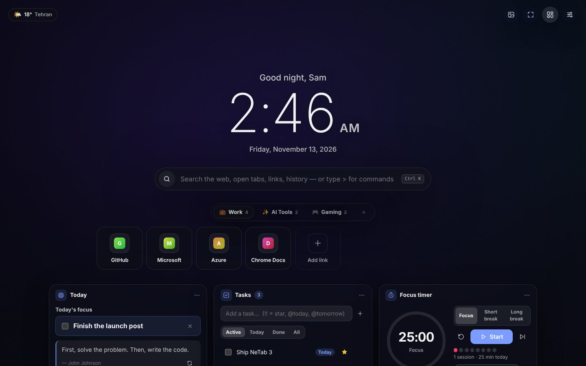
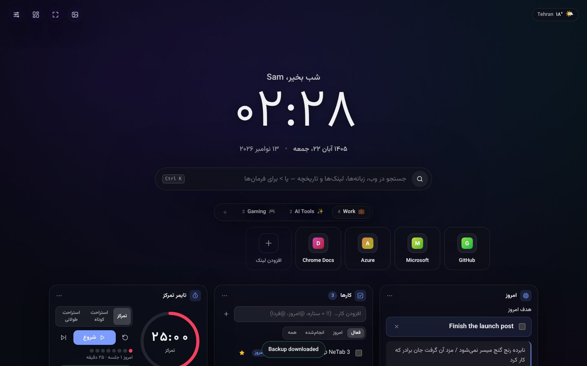
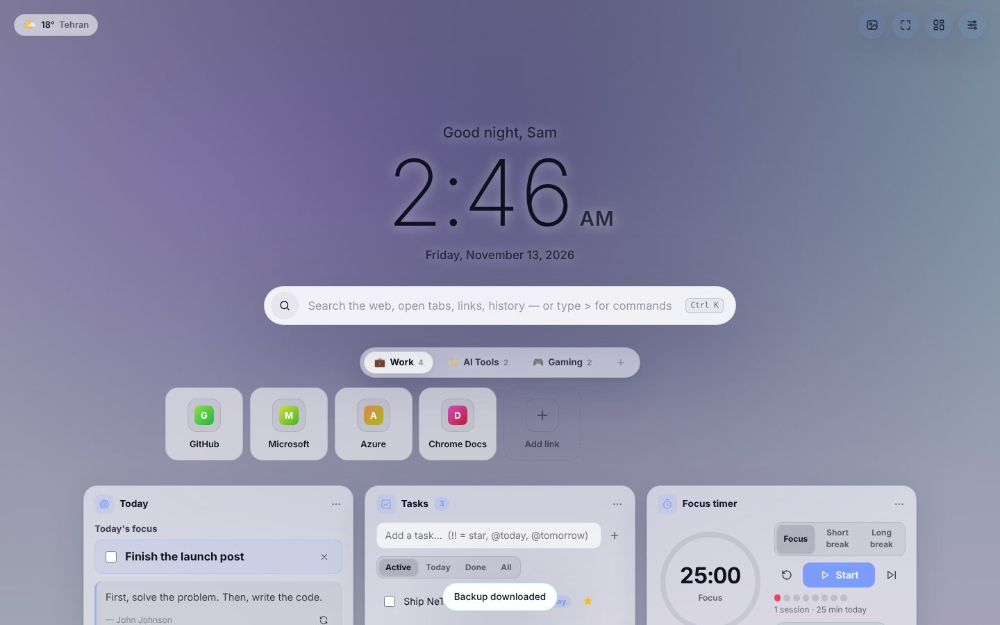
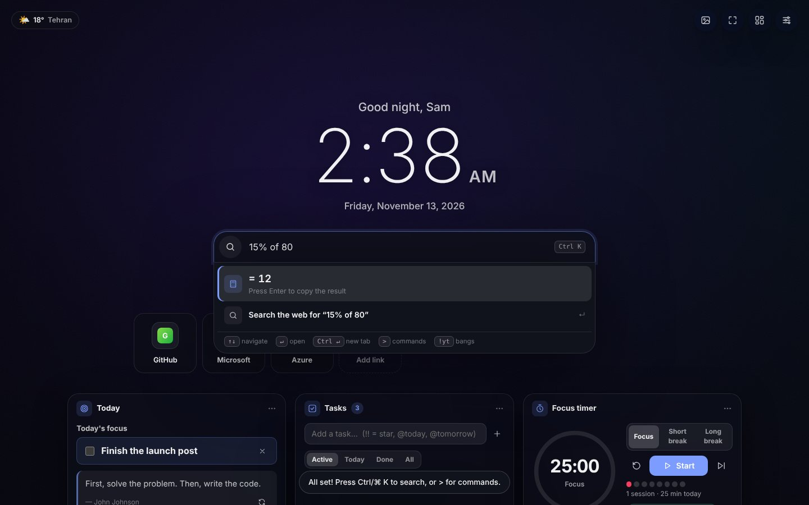
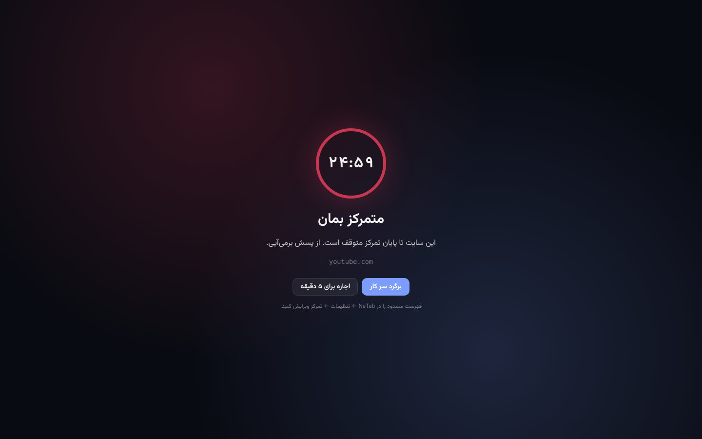
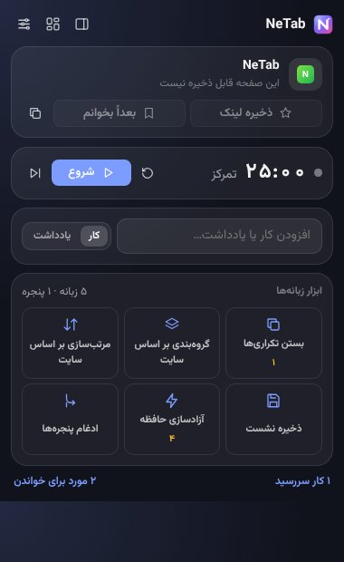
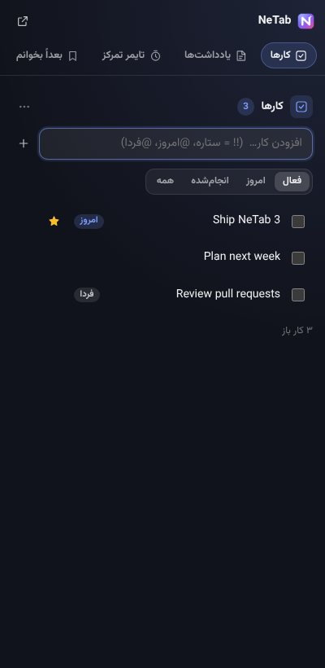
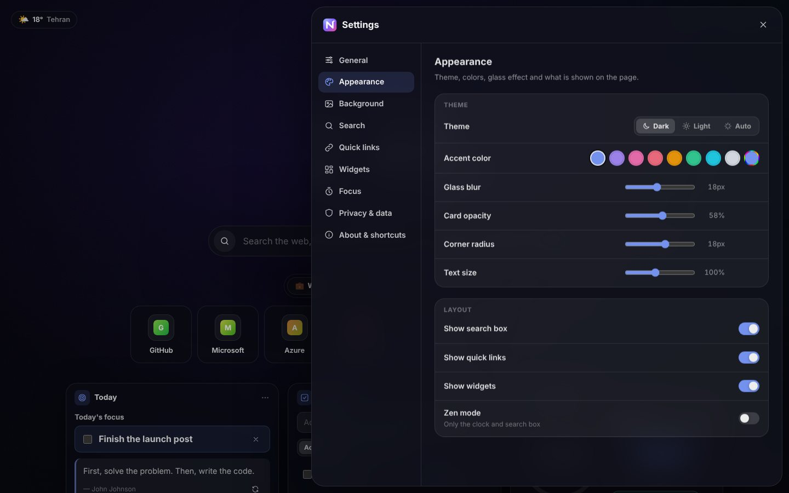

# NeTab

**A private, all-in-one productivity start page for Chrome.**
NeTab replaces the new tab page with a fast glass-style dashboard. It includes a smart search bar and command palette, a Pomodoro focus timer that blocks distracting sites, a tab manager with saved sessions, tasks, notes, a read-later list, weather, markets, and Gregorian, Jalali (Persian) and Hijri calendars. A toolbar popup and a side panel bring the same tools to every page.

No account, no servers, no analytics. Everything stays on your device. Full **English and Persian (فارسی, RTL)** interface.



<details>
<summary>More screenshots</summary>

| Persian (RTL) | Light theme |
| --- | --- |
|  |  |

| Search, calculator & commands | Focus blocking |
| --- | --- |
|  |  |

| Popup | Side panel | Settings |
| --- | --- | --- |
|  |  |  |

Full page: [dashboard-full.jpg](docs/screenshots/dashboard-full.jpg)

</details>

## Features

### Search box and command palette
- **Search engines and !bangs**: the browser default, Google, Bing, DuckDuckGo, Brave, ChatGPT, Claude, Perplexity, YouTube, GitHub, Wikipedia (EN/FA), Translate, Maps, Digikala, Aparat and more. Type `!yt lofi`, `lofi !yt`, `gh: netab`, or type `yt` and press <kbd>Tab</kbd>. You can also add your own engines.
- **Calculator and unit converter**: `12*(4+5)`, `sqrt(2)`, `5!`, `15% of 80`, `10 km to mi`, `30 c to f`, `2 gib to mb`, and `100 usd to eur` (uses cached rates). Persian digits work too.
- **One box for everything**: quick links, **open tabs** (switch to them), **bookmarks and history** (opt-in), and notes, with fuzzy matching and a "Top hit".
- **Commands**: type `>` to run any action: change theme or language, next wallpaper, start the focus timer, new note or task, save a session, close duplicate tabs, group tabs, free memory, merge windows, open the side panel, export a backup, or open Chrome pages (Downloads, History, Extensions, Passwords…).

### Focus timer (Pomodoro)
- Focus, short break and long break phases, with auto-start options, a daily goal, today's stats and a 7-day chart.
- Runs in the **service worker**, so the timer continues with no NeTab tab open. You get a **desktop notification and a chime** when each phase ends, and the **toolbar badge** shows the minutes left.
- **Distraction blocking**: while a focus phase runs, sites on your block list redirect to a calm "Stay focused" page with an "Allow 5 minutes" escape hatch.

### Tab manager
- Live counts of tabs, windows, duplicates and inactive tabs.
- **Close duplicates**, **group by site** (Chrome tab groups), sort by site, **free memory** (discard background tabs), and merge windows.
- **Saved sessions**: save the current window or every window, optionally close the tabs, then restore later into a new window or the current one.

### Tasks, notes and read later
- **Tasks**: `!!` stars a task. `@today`, `@tomorrow` or `@2026-12-31` set a due date (`@امروز`, `@فردا` in Persian). There are filters, inline editing, drag to reorder, and undo.
- **Notes**: multiple notes with autosave, pinning and search. `-` lists and `- [ ]` checkboxes continue automatically. Export one note or all of them to Markdown.
- **Read later**: save from the popup, the right-click menu or <kbd>Alt+Shift+L</kbd>.

### Widgets
Today (daily focus and a quote), Tasks, Focus timer, Weather (Open-Meteo, 6-day forecast), Calendar (Gregorian, Jalali, Hijri, with due-task dots), Notes, Markets (crypto, gold via PAXG, currencies), Read later, Tabs & sessions, World clock, and System (CPU, memory, battery). Turn them on or off and **drag to arrange**.

### Everywhere in Chrome
- **Popup**: save the current page to quick links or read later, copy it as a URL, a Markdown link or a **tracker-free URL**, control the focus timer, capture a task or note, and use the tab tools.
- **Side panel**: tasks, notes, focus, read later, sessions and calendar next to any page.
- **Right-click menu**: add a page to quick links, read later, save selected text to notes or as a task, search the selection, toggle focus, or save the window as a session.
- **Keyboard shortcuts**: <kbd>Alt+Shift+N</kbd> popup · <kbd>Alt+Shift+F</kbd> focus timer · <kbd>Alt+Shift+L</kbd> read later · <kbd>Alt+Shift+S</kbd> side panel.

### Look and feel
- Dark, light or auto theme, an accent color, and adjustable glass blur, card opacity, corner radius and text size.
- **Backgrounds**: animated gradient presets, a solid color, packaged photos and videos, or your own uploads (stored in IndexedDB). They can change every tab, every hour or every day, with darken, blur, zoom and volume controls.
- **Zen mode** (<kbd>Alt+Z</kbd>) shows only the clock and the search box.
- Big clock with greeting, 12/24-hour format, optional seconds, and two calendars in the date line (for example Jalali and Gregorian).
- Persian UI with the bundled **Vazirmatn** font, full RTL layout and Persian digits.

### Quick links
Groups appear as tabs and links as tiles or a list. Real site favicons are used, with letter tiles as a fallback. Add, edit and delete links inline, **drag to reorder**, **drop a tile on a group to move it**, or **paste a URL anywhere** on the page to add it. You can also import a bookmark folder, show Chrome's most-visited sites, and "Open all" for a group.

### Data and privacy
- Everything is in `chrome.storage.local` and IndexedDB. **Export or restore one JSON backup** (NeTab 2.x exports are accepted too) or reset everything.
- Optional permissions are requested only when you turn a feature on: bookmarks and history search, most-visited sites, weather, and markets. You can grant or revoke each one in **Settings → Privacy & data**.

## Install (developer mode)

1. Download or clone this repository.
2. Open `chrome://extensions/` and enable **Developer mode**.
3. Click **Load unpacked** and select the project folder.
4. Open a new tab. A short welcome screen asks for your name, language and widgets.

Requires Chrome 116 or newer.

## Keyboard shortcuts on the new tab page

| Keys | Action |
| --- | --- |
| <kbd>Ctrl/⌘ K</kbd> or <kbd>/</kbd> | Focus the search box |
| <kbd>></kbd> | Command palette |
| <kbd>↑</kbd> <kbd>↓</kbd> <kbd>Enter</kbd>, <kbd>Ctrl/⌘ Enter</kbd> | Navigate results, open in a new tab |
| <kbd>Alt Z</kbd> | Zen mode |
| <kbd>Alt B</kbd> | Next wallpaper |
| <kbd>Alt N</kbd> / <kbd>Alt T</kbd> | New note / new task |
| <kbd>Alt ,</kbd> | Settings |

## Private local configuration (optional)

The public repository only has safe sample links and media. Your personal setup can stay out of Git:

| Public (committed) | Private (git-ignored) |
| --- | --- |
| `data/links.json`, `data/media.json`, `media/samples/` | `data/links.local.json`, `data/media.local.json`, `media/photos/*`, `media/videos/*`, `.env` |

On first run NeTab loads `data/*.local.json` if present, otherwise the public defaults, and then keeps everything in browser storage. After editing the JSON files, use **Settings → Quick links / Background → Reload local JSON**. The `.env` workflow still works:

```bash
cp .env.example .env   # put JSON into NETAB_LINKS_JSON / NETAB_MEDIA_JSON
npm run sync:env       # writes data/links.local.json and data/media.local.json
```

## Development

No framework and no build step: plain ES modules, HTML and CSS, Manifest V3.

```text
manifest.json            MV3 manifest (permissions are listed in STORE_LISTING.md)
_locales/{en,fa}/        Store name & description
assets/                  Icons, logo, Vazirmatn font (OFL)
src/
  background/            Service worker: menus, commands, focus engine, blocking, badge
  newtab/                Dashboard: clock, search/palette, links, widgets, settings
    widgets/             One module per widget (shared with the side panel)
  popup/  sidepanel/  blocked/  options/  offscreen/
  lib/                   storage, i18n + strings, dates, calc, engines, focus, tabs, net, ui, icons
  styles/                Design tokens, components, widget styles
tests/                   Unit, i18n and end-to-end tests
scripts/                 validate, zip-release, sync-env, render-icons
```

```bash
npm test           # manifest/CSP/permission/security checks + unit & i18n tests (no dependencies)
npm run test:e2e   # loads the extension in Chromium via Playwright and drives every surface
npm run test:e2e -- --screens   # also refreshes docs/screenshots
npm run lint       # ESLint
npm run zip        # release/netab-chrome-webstore.zip + release/netab-public-source.zip
```

`npm test` blocks remote scripts, inline scripts and handlers, `eval`, `innerHTML`, unexpected permissions, required host permissions, and any `connect-src` beyond the four opt-in API hosts. It also checks that every import and asset path resolves, and that every UI string exists in both English and Persian.

## Chrome Web Store readiness

- Manifest V3, no remote code, strict CSP.
- No content scripts, no `<all_urls>`, no required host permissions.
- Network access only to opt-in public APIs (Open-Meteo, CoinGecko, ExchangeRate-API), after the user grants it.
- Permission justifications are in [`STORE_LISTING.md`](STORE_LISTING.md). The privacy policy is in [`PRIVACY.md`](PRIVACY.md).

Google controls the review, so no project can guarantee approval. This one is built to avoid the common rejection reasons.

---

## فارسی

**NeTab** صفحهٔ زبانهٔ جدید کروم را به یک داشبورد سریع، زیبا و کاملاً خصوصی تبدیل می‌کند:

- **جستجوی هوشمند و پالت فرمان**: جستجو در وب با میان‌برهای `!yt`، `!gh`، `!w`، `!gpt`، `!dk` (دیجی‌کالا) و `!ap` (آپارات)؛ ماشین‌حساب و تبدیل واحد (`۱۵% of 80`، `10 km to mi`)؛ جستجو در لینک‌ها، زبانه‌های باز، نشانک‌ها، تاریخچه و یادداشت‌ها؛ و اجرای هر فرمان با `>`.
- **تایمر تمرکز (پومودورو)** با اعلان، صدا، آمار روزانه و هفتگی و **مسدودسازی سایت‌های حواس‌پرت** در زمان تمرکز.
- **مدیریت زبانه‌ها**: بستن زبانه‌های تکراری، گروه‌بندی و مرتب‌سازی بر اساس سایت، آزادسازی حافظه، ادغام پنجره‌ها، و ذخیره و بازیابی نشست‌ها.
- **کارها، یادداشت‌ها و «بعداً بخوانم»** با نوشتار سریع (`!!` برای ستاره و `@امروز` یا `@فردا` برای موعد).
- **تقویم شمسی، میلادی و قمری**، ساعت جهانی، آب‌وهوا، و قیمت رمزارز، طلا و ارز.
- **پنجرهٔ نوار ابزار، پنل کناری و منوی کلیک راست** برای ذخیرهٔ صفحه، متن انتخاب‌شده، کار و یادداشت از هر صفحه‌ای.
- رابط کاملاً **فارسی و راست‌به‌چپ** با فونت وزیرمتن و اعداد فارسی، پوستهٔ تیره و روشن، و پس‌زمینهٔ گرادیان متحرک، عکس یا ویدیو.
- **بدون حساب کاربری و بدون ردیابی**: همهٔ داده‌ها روی دستگاه شما می‌ماند. از همه چیز می‌توانید پشتیبان JSON بگیرید و دوباره بازیابی کنید.

**نصب:** به `chrome://extensions` بروید، **Developer mode** را روشن کنید، **Load unpacked** را بزنید و پوشهٔ پروژه را انتخاب کنید. زبان را می‌توانید از **تنظیمات ← عمومی** عوض کنید.

## License

MIT, see [LICENSE](LICENSE). The Vazirmatn font is under the SIL Open Font License, see [assets/fonts/OFL.txt](assets/fonts/OFL.txt).
